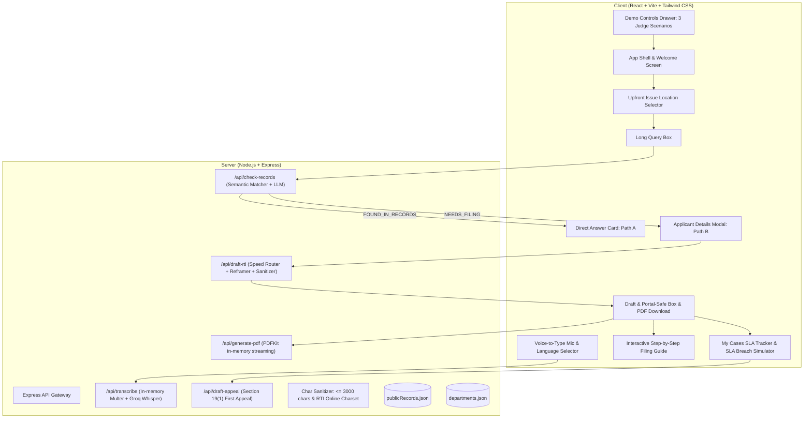

# Implementation Plan: RTI-Draft (Voice-First & Fast-Track Edition)

## 1. Architectural Foundation & Overview (Phase 1)

### What it is
**RTI-Draft (Voice-First & Fast-Track Edition)** is a civic-tech web application engineered to democratize access to Indian public authorities under the **Right to Information (RTI) Act, 2005** and **CPGRAMS**. It accepts natural speech and typed queries in **English, Telugu, and Hindi**, automatically detects whether information is already in public records, and drafts legally bulletproof, rejection-proof RTI applications or First Appeals when filing is needed.

### Core Value Proposition (The "Why")
- **Prevents 30-Day Delay for Public Information:** Under Section 4(1)(b) of the RTI Act, vast amounts of information (welfare scheme criteria, fee exemptions, land record portals, MGNREGA wages) are already published. RTI-Draft intercepts these queries and delivers **0-Day Instant Answers** without forcing users through forms or fees.
- **Eliminates Form Rejections:** Over 35% of citizen RTIs are rejected because citizens ask interrogative "Why" questions (which PIOs reject under Section 2(f)), violate the strict 3,000-character portal limit, use disallowed special characters on `rtionline.gov.in`, or file State/Municipal matters on the Central portal. RTI-Draft reframes questions into certified record requests, sanitizes characters, and routes to the correct jurisdiction.
- **Fast-Track Routing:** Automatically triggers **Section 7(1) 48-Hour Urgent Requests** for life/liberty emergencies, or **CPGRAMS Civic Grievances** for physical repair demands.

---

## 2. System Architecture & Tech Stack



### Component Details:
- **Frontend:** React 18 + Vite, Tailwind CSS, Lucide Icons. Web Speech API + in-memory Web Audio MediaRecorder fallback. Native `window.speechSynthesis` for Telugu/Hindi/English readback.
- **Backend:** Node.js (Express) with ES Modules. `multer` memory storage (zero temp audio files saved to disk).
- **Speech-to-Text (STT):** Groq `whisper-large-v3-turbo` with browser Web Speech API client fallback.
- **LLM Engine:** Groq (`llama-3.3-70b-versatile`) or Gemini (`gemini-2.5-flash` / `gemini-1.5-flash`), backed by a deterministic, zero-dependency `DEMO_MODE=true` offline engine.
- **PDF Engine:** `pdfkit` streaming binary buffers with custom clean typography and strict space-free filenames.

---

## 3. Directory & File Structure

```text
IdeaForge2/
├── rti_draft_mvp_specification.md   # Base specification reference
├── implementation_plan.md          # This implementation plan
├── .env.example                    # Environment variable template
├── README.md                       # Setup and run instructions
├── client/                         # React Frontend (Vite)
│   ├── index.html
│   ├── package.json
│   ├── vite.config.js
│   ├── tailwind.config.js
│   ├── postcss.config.js
│   └── src/
│       ├── main.jsx
│       ├── App.jsx
│       ├── index.css
│       ├── components/
│       │   ├── Header.jsx              # Navigation + Demo Drawer Trigger
│       │   ├── WelcomeScreen.jsx       # Greeting + Guardrails strip + CTA
│       │   ├── QueryIntakeForm.jsx     # Issue Location + Long Query Box + Mic
│       │   ├── VoiceClarification.jsx  # Smart 1-2 Voice Follow-up questions
│       │   ├── DirectAnswerCard.jsx    # Path A: 0-Day public record match
│       │   ├── ApplicantDetailsModal.jsx # Path B: Personal info (only if filing)
│       │   ├── DraftAndGuideView.jsx   # Speed badge, audit checklist, copy box
│       │   ├── PortalFilingGuide.jsx   # Step-by-step portal walkthrough
│       │   ├── TrackerDashboard.jsx    # My Cases + SLA Breach Simulation
│       │   └── DemoControlDrawer.jsx   # 3 One-click judge scenarios
│       ├── utils/
│       │   ├── api.js                 # Axios/Fetch client wrapper
│       │   ├── speechRecognition.js   # Browser speech fallback handler
│       │   ├── tts.js                 # Multilingual speech synthesis
│       │   └── sanitizer.js           # Frontend copy-box validator
│       └── data/
│           └── locations.js           # States, districts, wards lookup helper
└── server/                         # Express Backend
    ├── package.json
    ├── index.js                    # Server entrypoint & route registration
    ├── data/
    │   ├── publicRecords.json      # Curated public record knowledge base
    │   └── departments.json        # Central (30) + State/Municipal (20) directory
    ├── routes/
    │   ├── transcribe.js           # POST /api/transcribe
    │   ├── records.js              # POST /api/check-records
    │   ├── draft.js                # POST /api/draft-rti
    │   ├── appeal.js               # POST /api/draft-appeal
    │   └── pdf.js                  # POST /api/generate-pdf
    ├── prompts/
    │   ├── recordCheck.js          # Prompts for Section 4 disclosure checking
    │   ├── rtiReframer.js          # Prompts for Section 6(1) record reframing
    │   └── firstAppeal.js          # Prompts for Section 19(1) appeals
    ├── utils/
    │   ├── sanitizer.js            # Strict character & length sanitizer
    │   └── pdfGenerator.js         # PDFKit document builder
    └── services/
        ├── groqService.js          # Groq Whisper and LLaMA client
        ├── geminiService.js        # Gemini client fallback
        └── demoService.js          # Deterministic DEMO_MODE fallback data
```

---

## 4. Backend API Contracts

### 1. `POST /api/transcribe`
- **Request:** `multipart/form-data` with `audio` (Buffer) and `language` (`"auto" | "en" | "te" | "hi"`).
- **Behavior:** Reads audio directly from RAM via `multer.memoryStorage()`. Forwards buffer to Groq Whisper (`whisper-large-v3-turbo`). If `DEMO_MODE=true` or offline, returns contextual mock speech transcription.
- **Response:**
```json
{
  "transcript": "My street road in Ward 12 was dug up 6 months ago and never fixed. I want the contractor name and sanctioned budget.",
  "detected_language": "en"
}
```

### 2. `POST /api/check-records`
- **Request:**
```json
{
  "query": "Do I have to pay an RTI fee if I have a BPL card?",
  "issueLocation": { "state": "Telangana", "district": "Nalgonda", "ward": "" },
  "language": "en"
}
```
- **Response (Path A: Match Found):**
```json
{
  "status": "FOUND_IN_RECORDS",
  "direct_answer": "Under Section 7(5) of the RTI Act, 2005, applicants holding a Below Poverty Line (BPL) card are completely exempt from paying the Rs. 10 application fee and all document copy charges. You only need to attach a copy of your valid BPL certificate (PDF under 1 MB).",
  "source_name": "RTI Online Official FAQ (DoPT, Govt of India)",
  "source_url": "https://rtionline.gov.in/guidelines.php",
  "voice_summary": "Good news! With a valid BPL card, your RTI fee is zero rupees. You do not need to file a separate RTI to check this."
}
```
- **Response (Path B: Needs Official Filing):**
```json
{
  "status": "NEEDS_FILING",
  "clarifying_questions": [],
  "reason": "Specific ward-level road repair bills and contractor work orders are not publicly listed online. Let us prepare an official RTI / Fast-Track request for you."
}
```
- **Response (Path C: Needs Clarification):**
```json
{
  "status": "NEEDS_CLARIFICATION",
  "clarifying_questions": [
    "Is this road repair work currently ongoing or was it abandoned by the contractor?",
    "Does this situation pose an immediate life hazard or medical emergency?"
  ],
  "reason": "Missing work phase and emergency status needed for optimal fast-track routing."
}
```

### 3. `POST /api/draft-rti`
- **Request:**
```json
{
  "query": "My street road in Ward 12 was dug up 6 months ago and never fixed. I want the contractor name and sanctioned budget.",
  "issueLocation": { "state": "Telangana", "district": "Nalgonda", "ward": "Ward 12" },
  "applicant": {
    "name": "Ramesh Kumar",
    "address": "H.No 4-2-11, Ramagiri, Nalgonda, Telangana - 508001",
    "is_bpl": false,
    "phone": "9876543210"
  },
  "language": "en"
}
```
- **Response:**
```json
{
  "recommended_track": "STANDARD_RTI",
  "estimated_response_time": "Up to 30 Days (or CPGRAMS Fast-Track for Repair Action)",
  "jurisdiction": "STATE",
  "jurisdiction_warning": "This is a Municipal/State matter. Do NOT file on rtionline.gov.in; submit via the Telangana State RTI portal or Speed Post to the Municipal Commissioner (PIO).",
  "department_match": {
    "name": "Nalgonda Municipal Corporation (Engineering Wing)",
    "officer": "Public Information Officer (Municipal Commissioner)",
    "portal_url": "https://rti.telangana.gov.in"
  },
  "reframed_questions": [
    "1. Provide a certified copy of the work order, estimate, and sanctioned budget for the road excavation/repair in Ward 12, Nalgonda for FY 2025-26.",
    "2. Provide the registered business name and contact details of the contractor awarded this work.",
    "3. Provide the stipulated start and completion dates as recorded in the agreement.",
    "4. Provide certified copies of all site inspection notes and quality test reports recorded by the Executive Engineer to date."
  ],
  "portal_safe_text": "Subject: Application under Section 6(1) of the RTI Act, 2005.\n\nTo:\nThe Public Information Officer (PIO),\nNalgonda Municipal Corporation, Telangana.\n\nApplicant: Ramesh Kumar, H.No 4-2-11, Ramagiri, Nalgonda - 508001.\n\nSir/Madam,\nPlease provide certified records under Section 2(j) of the RTI Act, 2005 regarding the pending road work in Ward 12, Nalgonda:\n\n1. Certified copy of work order and sanctioned budget for road repair in Ward 12.\n2. Registered name and details of the awarded contractor.\n3. Stipulated start and completion dates on official record.\n4. Certified copies of site inspection reports by the Executive Engineer.\n\nApplication fee of Rs. 10 is paid via Postal Order / Online Portal.\n\nYours faithfully,\nRamesh Kumar",
  "char_count": 682,
  "fee_calculation": {
    "amount_inr": 10,
    "note": "Standard State RTI fee via Portal or Indian Postal Order."
  },
  "filing_guide_steps": [
    "1. Open the Telangana State RTI Portal (or prepare Speed Post to the Municipal Commissioner, Nalgonda).",
    "2. Select Department: Municipal Administration & Urban Development.",
    "3. Paste the sanitized text from the box above into the 'Text for RTI Request' field.",
    "4. Pay the Rs. 10 fee (or upload your BPL certificate PDF under 1 MB with no spaces in the filename).",
    "5. Save the Registration Number and click 'Save to My Cases' below to track your deadline."
  ],
  "rejection_audit": {
    "no_why_questions": true,
    "no_section_8_violation": true,
    "within_3000_chars": true,
    "portal_safe_charset": true
  },
  "native_summary": "Your RTI draft for Ward 12 road work records is ready. Because this is a municipal matter, submit it to the Telangana Municipal office, not the Central portal."
}
```

### 4. `POST /api/draft-appeal`
- **Request:**
```json
{
  "caseId": "CASE-1718000000",
  "originalSubject": "Ward 12 Road Repair Records",
  "originalRegistrationNumber": "NMC/RTI/2026/00142",
  "pioDetails": "Public Information Officer, Nalgonda Municipal Corporation",
  "faaDetails": "First Appellate Authority / Municipal Commissioner, Nalgonda",
  "applicant": {
    "name": "Ramesh Kumar",
    "address": "H.No 4-2-11, Ramagiri, Nalgonda - 508001"
  },
  "filingDate": "2026-10-20",
  "ground": "NO_RESPONSE"
}
```
- **Response:**
```json
{
  "appeal_title": "First Appeal under Section 19(1) of the Right to Information Act, 2005",
  "faa_recipient": "The First Appellate Authority (FAA), Nalgonda Municipal Corporation",
  "legal_grounds": "Deemed refusal under Section 7(2) due to non-response within the statutory 30-day SLA. Information must now be provided completely free of charge under Section 7(6).",
  "portal_safe_text": "Subject: First Appeal under Section 19(1) of the RTI Act, 2005 against deemed refusal.\n\nTo:\nThe First Appellate Authority (FAA),\nNalgonda Municipal Corporation, Telangana.\n\nApplicant: Ramesh Kumar, H.No 4-2-11, Ramagiri, Nalgonda - 508001.\nOriginal RTI Reg No: NMC/RTI/2026/00142 filed on 2026-10-20.\n\nSir/Madam,\n1. The applicant filed an RTI application under Section 6(1) on 2026-10-20 seeking certified records of Ward 12 road repairs.\n2. More than 30 days have elapsed, and the PIO has failed to provide any information or communication.\n3. Under Section 7(2), this constitutes a deemed refusal.\n4. Prayer: Direct the PIO to immediately furnish the certified records free of cost as mandated by Section 7(6) of the RTI Act, 2005, and initiate penal proceedings under Section 20.\n\nYours faithfully,\nRamesh Kumar",
  "char_count": 748,
  "filing_instructions": [
    "Submit this First Appeal to the First Appellate Authority (FAA) via State RTI Portal or Registered Speed Post.",
    "Attach a copy of your original RTI application and receipt/acknowledgment.",
    "No fee is payable for filing a First Appeal under RTI Online rules."
  ]
}
```

### 5. `POST /api/generate-pdf`
- **Request:**
```json
{
  "type": "RTI" | "URGENT_48HR" | "FIRST_APPEAL" | "CPGRAMS",
  "draftData": { ... }
}
```
- **Response:** Binary PDF stream (`Content-Type: application/pdf`).
- **Filename Header:** `Content-Disposition: attachment; filename="RTI_Request_Ward12_Nalgonda_20261122.pdf"` (strictly ZERO spaces).

---

## 5. RTI Online Sanitization & Regex Engine

### Validation Rules for `rtionline.gov.in`
1. **Length Limit:** Maximum `3,000` characters. Anything above is trimmed cleanly at word boundaries.
2. **Allowed Character Set:**
   - Uppercase & Lowercase English letters: `A-Z`, `a-z`
   - Numeric digits: `0-9`
   - Permitted symbols: `,` `.` `-` `_` `(` `)` `/` `@` `:` `&` `?` `\` `%`
   - Whitespace: Space, newline, carriage return, tab (`\s`)
3. **Disallowed Characters (Must be stripped or converted):**
   - Quotes: `"` and `'` $\rightarrow$ converted to spaces or empty strings
   - Exclamation & Semicolon: `!` $\rightarrow$ `.`, `;` $\rightarrow$ `,`
   - Math/Programming symbols: `< > = + * # $ ^ ~ | { } [ ]` $\rightarrow$ stripped or sanitized
   - Non-ASCII / Emoticons: Stripped entirely from portal text (retaining English/ASCII for the portal text box, while providing full regional language view on the UI and PDF).

### Exact Implementation Regex (`server/utils/sanitizer.js`):
```javascript
export function sanitizeRtiText(rawText, maxLen = 3000) {
  if (!rawText) return "";
  
  // 1. Replace quotes and dangerous brackets with portal-safe equivalents
  let text = rawText
    .replace(/["']/g, "")
    .replace(/[;]/g, ",")
    .replace(/[!]/g, ".")
    .replace(/[\u201C\u201D\u2018\u2019]/g, "") // curly quotes
    .replace(/[\u2013\u2014]/g, "-");           // en-dash, em-dash

  // 2. Remove all characters outside the RTI Online allowed character set
  // Allowed: A-Za-z0-9 , . - _ ( ) / @ : & ? \ % and whitespace
  text = text.replace(/[^A-Za-z0-9,.\-_()/@:&?\\%\s]/g, "");

  // 3. Normalize repetitive whitespace but preserve clean paragraph structure
  text = text.replace(/[ \t]+/g, " ").replace(/\n{3,}/g, "\n\n").trim();

  // 4. Enforce strict character limit (<= 3000)
  if (text.length > maxLen) {
    text = text.slice(0, maxLen);
    // Trim back to the last clean sentence or space to prevent cutting mid-word
    const lastSpace = text.lastIndexOf(" ");
    if (lastSpace > maxLen - 100) {
      text = text.slice(0, lastSpace);
    }
  }

  return text;
}

export function validateRtiCharset(text) {
  const disallowedRegex = /[^A-Za-z0-9,.\-_()/@:&?\\%\s]/;
  return !disallowedRegex.test(text) && text.length <= 3000;
}
```

---

## 6. Knowledge Base Schemas

### `server/data/publicRecords.json`
Pre-curated with 8+ verified public portals and Section 4 disclosures:
1. **BPL RTI Fee Exemption:** Section 7(5) exemption from Rs. 10 fee & copy charges. Source: `rtionline.gov.in`.
2. **MGNREGA Wage Rates & Job Cards:** Daily wage lookup and Muster Roll tracking via `nrega.nic.in`.
3. **PM-KISAN Samman Nidhi Status:** Beneficiary status and Aadhaar OTP verification via `pmkisan.gov.in`.
4. **Municipal Property Tax & Assessment:** Online PTIN search and mutation records on State Municipal portals.
5. **NFSA Ration Card Entitlement:** 5 kg food grains per month under PMGKAY via `nfsa.gov.in`.
6. **Voter ID / Electoral Roll Search:** EPIC status verification via `voters.eci.gov.in`.
7. **PMAY Urban/Gramin Beneficiary List:** Search by BPL/SECC ID on `pmaymis.gov.in`.
8. **Drinking Water Quality & Tariff SLA:** Municipal Water Board Citizen Charter.

### `server/data/departments.json`
- **Central Authorities (30 Entries):** Ministry of Road Transport, Railways, Health & Family Welfare, Rural Development, Housing & Urban Affairs, Department of Posts, EPFO, ESIC, CBDT, CBIC, Telecom, Consumer Affairs, etc. Mapped to `rtionline.gov.in` and `pgportal.gov.in`.
- **State & Municipal Authorities (20 Entries):** Municipal Corporation (Engineering Wing), Municipal Corporation (Health & Sanitation), State PWD, State Electricity Distribution Company (DISCOM), Water Supply & Drainage Board, District Revenue Office (Collectorate/Tahsildar), District Hospital Superintendent, Transport Department (RTO), State Police, etc. Mapped with jurisdiction warning: `"STATE"`.

---

## 7. Verification Plan & Test Matrix

### Test Path 1: Instant Public Record Match (Path A — 0 Days)
- **Action:** Open app, click "Register a Problem", select "Telangana, Nalgonda", enter query: *"Do I have to pay an RTI fee if I have a BPL card?"*
- **Verification:**
  1. Backend returns `FOUND_IN_RECORDS`.
  2. Frontend renders `DirectAnswerCard.jsx` with Section 7(5) rule, source link, and TTS readback button.
  3. Form for personal details is **never displayed**.

### Test Path 2: 48-Hour Urgent RTI (Path B: Section 7(1) Life & Liberty)
- **Action:** Select Demo Scenario B: *"My father is admitted in Govt General Hospital, Nalgonda and needs his MRI report urgently to shift hospitals."*
- **Verification:**
  1. Backend returns `NEEDS_FILING` and classifies as `URGENT_48HR`.
  2. Prompts for applicant details via modal.
  3. Generates RTI draft with bold red 48-Hour Urgent Badge and Section 7(1) invocation.
  4. Downloads `RTI_Urgent_GGH_Nalgonda_20261122.pdf` (zero spaces in filename).
  5. Step-by-step guide directs to hand-deliver or Speed Post to Hospital PIO.

### Test Path 3: Standard Local RTI + SLA Breach Simulation (Path B + SLA Tracker)
- **Action:** Select Demo Scenario C: *"Ward 12 road in Nalgonda was dug up 6 months ago; I want the sanctioned budget and contractor details."*
- **Verification:**
  1. Backend identifies jurisdiction as `STATE` and displays amber warning against filing on `rtionline.gov.in`.
  2. Reframes "Why" into 4 numbered Section 6(1) record questions.
  3. Sanitizes copy-box to $\le 3,000$ characters and allowed RTI charset.
  4. Saves case to "My Cases" tracker with 30-day countdown.
  5. User clicks **"Simulate SLA Breach (No Reply)"**:
     - Status updates to `OVERDUE (31 Days)`.
     - 1-click **"Generate First Appeal (Section 19(1))"** button activates.
     - Downloads `Section19_1_FirstAppeal_Ward12_Nalgonda.pdf` with Section 7(6) free information claim.

### Test Path 4: Offline / `DEMO_MODE=true` Immunity
- **Action:** Run server with empty API keys (`DEMO_MODE=true`).
- **Verification:**
  - Full voice-to-type, record check, RTI drafting, appeal generation, and PDF streaming execute end-to-end without unhandled promise rejections or external network failures.
